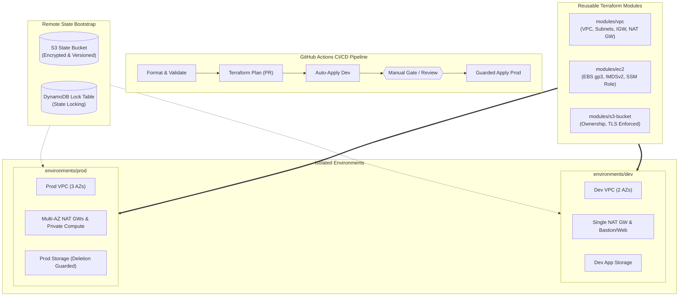

# Production-Grade AWS Terraform Infrastructure Boilerplate

[](https://www.terraform.io/)
[](https://registry.terraform.io/providers/hashicorp/aws/latest)
[](.github/workflows/terraform.yml)
[](LICENSE)

An enterprise-ready, modular, and scalable Terraform infrastructure boilerplate designed for provisioning secure multi-tier AWS environments. Built following AWS Well-Architected Framework and HashiCorp Infrastructure as Code (IaC) best practices.

---

## 🏛️ Architecture Overview

This repository decouples infrastructure definitions into reusable modules and isolated environment orchestrations:



---

## 📂 Repository Layout

```text
terraform-aws-setup/
├── modules/                    # Reusable, self-contained Terraform modules
│   ├── vpc/                    # Modular VPC, multi-AZ subnets, IGW, and NAT GW
│   │   ├── main.tf
│   │   ├── variables.tf
│   │   └── outputs.tf
│   ├── ec2/                    # Compute instance with IMDSv2, gp3, & SSM profile
│   │   ├── main.tf
│   │   ├── variables.tf
│   │   └── outputs.tf
│   └── s3-bucket/              # Secure S3 bucket with TLS enforcement & lifecycle
│       ├── main.tf
│       ├── variables.tf
│       └── outputs.tf
├── environments/               # Root modules deploying stacks per environment
│   ├── dev/                    # Development environment (cost-optimized single NAT)
│   │   ├── main.tf
│   │   ├── variables.tf
│   │   ├── outputs.tf
│   │   └── terraform.tfvars.example
│   └── prod/                   # Production environment (high-availability multi-AZ)
│       ├── main.tf
│       ├── variables.tf
│       ├── outputs.tf
│       └── terraform.tfvars.example
├── bootstrap/                  # Remote state backend setup (S3 + DynamoDB locking)
│   ├── main.tf
│   ├── outputs.tf
│   └── variables.tf
├── .github/
│   └── workflows/
│       └── terraform.yml       # Production-ready GitHub Actions CI/CD workflow
├── .gitignore                  # Comprehensive Terraform gitignore
├── .env.example                # Local environment variables template
├── LICENSE                     # MIT License
└── README.md                   # Project documentation
```

---

## 🧩 Module Specifications

### 1. `modules/vpc`
- **Dynamic Subnet Slicing:** Automatically distributes subnets across availability zones.
- **NAT Gateway Strategies:** Configurable between single NAT (cost-optimized for dev) and multi-AZ NATs (fault-tolerant for prod).
- **Public & Private Routing:** Isolated private routing tables connected through NAT gateways for outbound-only access.

### 2. `modules/ec2`
- **Dynamic AMI Lookup:** Automatically resolves the latest official Amazon Linux 2023 or custom AMIs without hardcoding AMI IDs.
- **Zero-Trust Access (SSM):** Provisions an IAM Instance Profile attached to `AmazonSSMManagedInstanceCore` so servers can be accessed securely using AWS Systems Manager Session Manager with port 22 closed.
- **IMDSv2 Enforced:** Blocks Server-Side Request Forgery (SSRF) by requiring IMDSv2 session tokens.
- **Storage Standards:** Root EBS volume formatted with encrypted `gp3` by default.

### 3. `modules/s3-bucket`
- **Bucket Owner Enforced:** Disables legacy S3 ACLs in favor of modern IAM policies.
- **Strict Public Access Block:** Explicitly prevents public exposure.
- **SSL/TLS Enforcement:** Deploys a bucket policy denying non-HTTPS requests (`aws:SecureTransport = false`).
- **Lifecycle Policies:** Automatic cleanup of incomplete multipart uploads and non-current versions.

---

## 🚀 Step-by-Step Deployment Guide

### Prerequisites
- [Terraform CLI](https://developer.hashicorp.com/terraform/downloads) `>= 1.5.0`
- [AWS CLI](https://aws.amazon.com/cli/) configured with deployment permissions
- Active AWS Account

---

### Step 1: Bootstrap the Remote State Backend

Before provisioning environments, create the dedicated S3 state bucket and DynamoDB locking table:

```bash
cd bootstrap
terraform init
terraform plan
terraform apply
```

Upon completion, Terraform will output your backend configuration block:

```hcl
terraform {
  backend "s3" {
    bucket         = "terraform-aws-setup-tf-state-xxxxxxxx"
    key            = "dev/terraform.tfstate"
    region         = "ap-south-1"
    dynamodb_table = "terraform-aws-setup-tf-locks"
    encrypt        = true
  }
}
```

Copy these values into your `environments/dev/main.tf` and `environments/prod/main.tf` backend blocks.

---

### Step 2: Deploy Development (`dev`)

1. Navigate to the dev directory:
   ```bash
   cd ../environments/dev
   ```

2. Create your variable definition file:
   ```bash
   cp terraform.tfvars.example terraform.tfvars
   ```

3. Initialize, plan, and apply:
   ```bash
   terraform init
   terraform plan -out=tfplan
   terraform apply tfplan
   ```

---

### Step 3: Deploy Production (`prod`)

1. Navigate to the prod directory:
   ```bash
   cd ../environments/prod
   ```

2. Create your production variable definitions:
   ```bash
   cp terraform.tfvars.example terraform.tfvars
   ```

3. Initialize, plan, and apply:
   ```bash
   terraform init
   terraform plan -out=tfplan
   terraform apply tfplan
   ```

---

## 🔒 Security & Compliance Best Practices

| Control | Implementation |
|---|---|
| **Remote State Encryption** | S3 bucket encrypted with AES256 server-side encryption |
| **Concurrent Execution Lock**| DynamoDB table with `LockID` hash key prevents race conditions |
| **Metadata Protection** | IMDSv2 `http_tokens = required` enforced on all EC2 instances |
| **Access Management** | AWS Systems Manager (SSM) avoids exposing SSH port 22 |
| **S3 Hardening** | Public access blocks enabled, TLS 1.2+ forced via bucket policies |
| **Zero Hardcoded Secrets** | Credentials passed via environment variables or AWS IAM roles |

---

## 🤖 CI/CD Automation with GitHub Actions

The pipeline (`.github/workflows/terraform.yml`) implements an automated GitOps workflow:

1. **Lint & Validation:** Checks code formatting with `terraform fmt -check` and syntax with `terraform validate` across all root modules.
2. **Pull Request Automation:** Automatically executes `terraform plan` and publishes the plan summary directly as a PR comment.
3. **Automated Dev Deployment:** Automatically applies changes to the `dev` environment on merges to `main`.
4. **Guarded Production Deployment:** Deploys to `prod` requiring manual review and approval via GitHub Environment protection rules.

### Configuring Secrets in GitHub
Configure the following secrets in your repository settings (**Settings > Secrets and variables > Actions**):
- `AWS_ACCESS_KEY_ID`
- `AWS_SECRET_ACCESS_KEY`

*(Note: For enterprise environments, migrating to AWS OIDC authentication via `aws-actions/configure-aws-credentials` is recommended.)*

---

## 🧹 Teardown

To destroy provisioned infrastructure:

```bash
# Destroy Dev
cd environments/dev
terraform destroy -auto-approve

# Destroy Prod
cd ../prod
terraform destroy -auto-approve

# Destroy Bootstrap State (if completely decommissioning)
cd ../../bootstrap
terraform destroy
```

---

## 📄 License

This repository is licensed under the [MIT License](LICENSE).
