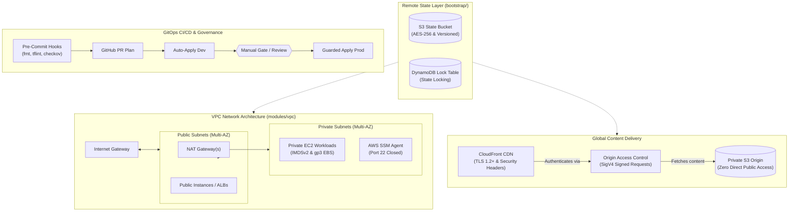

# Production-Grade AWS Terraform Infrastructure Boilerplate

[](.github/workflows/terraform.yml)
[](https://www.terraform.io/)
[](https://registry.terraform.io/providers/hashicorp/aws/latest)
[](.pre-commit-config.yaml)
[](tests/)
[](LICENSE)

An enterprise-ready, modular, and highly secure Terraform boilerplate engineered for multi-tier AWS deployments. Built from the ground up following the **AWS Well-Architected Framework**, **HashiCorp IaC best practices**, and **CIS AWS Foundations Benchmarks**.

---

## 🏛️ System Architecture



---

## 📂 Repository Directory Layout

```text
terraform-aws-setup/
├── modules/                        # Reusable, self-contained Terraform modules
│   ├── vpc/                        # Modular VPC, multi-AZ subnets, IGW, and NAT GW
│   │   ├── main.tf
│   │   ├── variables.tf
│   │   └── outputs.tf
│   ├── ec2/                        # Dynamic AMI, IMDSv2, gp3, & SSM instance profile
│   │   ├── main.tf
│   │   ├── variables.tf
│   │   └── outputs.tf
│   ├── s3-bucket/                  # Secure S3 bucket with TLS enforcement & lifecycle
│   │   ├── main.tf
│   │   ├── variables.tf
│   │   └── outputs.tf
│   └── cloudfront-s3/              # Static hosting via CloudFront CDN & Origin Access Control
│       ├── main.tf
│       ├── variables.tf
│       └── outputs.tf
├── environments/                   # Isolated environment root stacks
│   ├── dev/                        # Dev environment (cost-optimized single NAT)
│   │   ├── main.tf
│   │   ├── variables.tf
│   │   ├── outputs.tf
│   │   └── terraform.tfvars.example
│   └── prod/                       # Production environment (HA multi-AZ & CloudFront CDN)
│       ├── main.tf
│       ├── variables.tf
│       ├── outputs.tf
│       └── terraform.tfvars.example
├── bootstrap/                      # Remote state backend setup (S3 + DynamoDB locking)
│   ├── main.tf
│   ├── outputs.tf
│   └── variables.tf
├── examples/                       # Complete reference implementations
│   └── complete-infrastructure/    # End-to-end integrated stack wiring all modules
│       ├── main.tf
│       ├── variables.tf
│       ├── outputs.tf
│       └── README.md
├── tests/                          # Automated infrastructure validation suite
│   ├── go.mod
│   ├── vpc_test.go                 # Terratest unit tests for VPC
│   └── infrastructure_test.go      # Terratest integration tests for S3 security
├── .github/
│   ├── workflows/
│   │   └── terraform.yml           # CI/CD: format check, validate, PR plan, auto/gated apply
│   └── ISSUE_TEMPLATE/
│       ├── bug_report.md           # Standardized bug reporting template
│       └── feature_request.md      # Structured feature enhancement proposal
├── .pre-commit-config.yaml         # Pre-commit hooks (fmt, validate, tflint, checkov)
├── .tflint.hcl                     # TFLint configuration with AWS ruleset
├── .gitignore                      # Comprehensive Terraform & cloud gitignore
├── .env.example                    # Local environment variables template
├── CONTRIBUTING.md                 # Contribution standards and development guidelines
├── CODE_OF_CONDUCT.md              # Contributor Covenant v2.1 code of conduct
├── LICENSE                         # MIT License
└── README.md                       # Project documentation
```

---

## ⚡ Quick-Start Guide

### Prerequisites
- [Terraform CLI](https://developer.hashicorp.com/terraform/downloads) `>= 1.5.0`
- [AWS CLI](https://aws.amazon.com/cli/) configured with valid deployment credentials
- [pre-commit](https://pre-commit.com/) (recommended for local contributions)

---

### Phase 1: Initialize the Remote State Backend (`bootstrap/`)

Before orchestrating environments, create the dedicated S3 state bucket and DynamoDB locking table:

```bash
cd bootstrap
terraform init
terraform plan
terraform apply -auto-approve
```

The bootstrap outputs provide your exact `backend "s3"` configuration snippet:

```hcl
terraform {
  backend "s3" {
    bucket         = "terraform-aws-setup-tf-state-xxxx"
    key            = "prod/terraform.tfstate"
    region         = "ap-south-1"
    dynamodb_table = "terraform-aws-setup-tf-locks"
    encrypt        = true
  }
}
```

---

### Phase 2: Deploy Environments

#### 1. Development Environment (`environments/dev/`)
Designed for rapid prototyping and cost efficiency (single NAT Gateway, public bastion/web access):

```bash
cd ../environments/dev
cp terraform.tfvars.example terraform.tfvars
terraform init
terraform plan -out=tfplan
terraform apply tfplan
```

#### 2. Production Environment (`environments/prod/`)
Engineered for fault tolerance and zero-trust security (multi-AZ redundant NAT Gateways, private compute instances, CloudFront with OAC):

```bash
cd ../prod
cp terraform.tfvars.example terraform.tfvars
terraform init
terraform plan -out=tfplan
terraform apply tfplan
```

#### 3. Complete End-to-End Reference Example (`examples/complete-infrastructure/`)
A single unified deployment demonstrating all modules wired together:

```bash
cd ../../examples/complete-infrastructure
terraform init
terraform plan
terraform apply
```

---

## 🔒 Security & Compliance Architecture

| Security Domain | Architectural Implementation |
|---|---|
| **Zero Direct S3 Access** | S3 origins block 100% of public access; access is restricted exclusively to CloudFront via **Origin Access Control (OAC)** SigV4 signatures. |
| **Transport Encryption** | All S3 buckets attach explicit bucket policies enforcing TLS (`aws:SecureTransport = false` deny). CloudFront enforces HTTP-to-HTTPS redirection with modern TLS 1.2+ protocols. |
| **Instance Hardening** | All EC2 instances enforce **IMDSv2** (`http_tokens = required`) to block SSRF token theft. |
| **Zero-Trust Access** | Port 22 (SSH) remains closed by default; instances attach an IAM Instance Profile granting access via **AWS Systems Manager (SSM) Session Manager**. |
| **Storage Security** | Root EBS volumes utilize encrypted **`gp3`** storage with termination protection. |
| **Remote State Locking** | S3 state bucket is versioned and encrypted; DynamoDB state locking prevents concurrent execution race conditions. |

---

## 🧪 Automated Testing & Code Quality

### 1. Pre-Commit Hooks
Run automated format checks, linting, and policy-as-code security scans locally before pushing:

```bash
pre-commit install
pre-commit run --all-files
```

### 2. Terratest Infrastructure Suite
Run automated Go-based integration tests to validate modules against live AWS sandbox environments:

```bash
cd tests
go test -v -timeout 30m
```

---

## 🤝 Contributing & Community

We welcome contributions! Please review our guidelines before submitting a pull request:
- [Contributing Guidelines](CONTRIBUTING.md)
- [Code of Conduct](CODE_OF_CONDUCT.md)
- [Report a Bug](.github/ISSUE_TEMPLATE/bug_report.md)
- [Request a Feature](.github/ISSUE_TEMPLATE/feature_request.md)

---

## 📄 License

This repository is distributed under the [MIT License](LICENSE).
